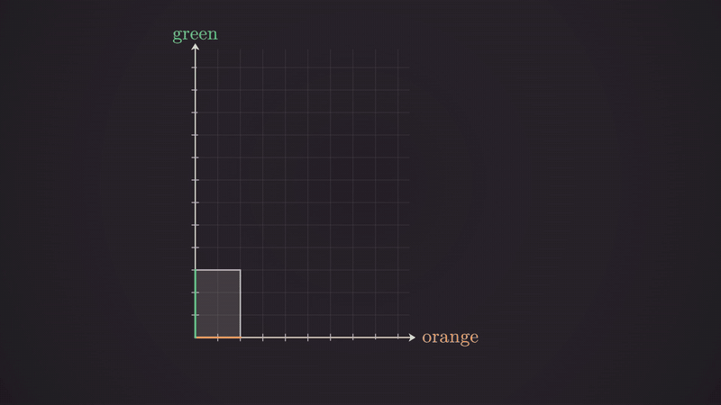
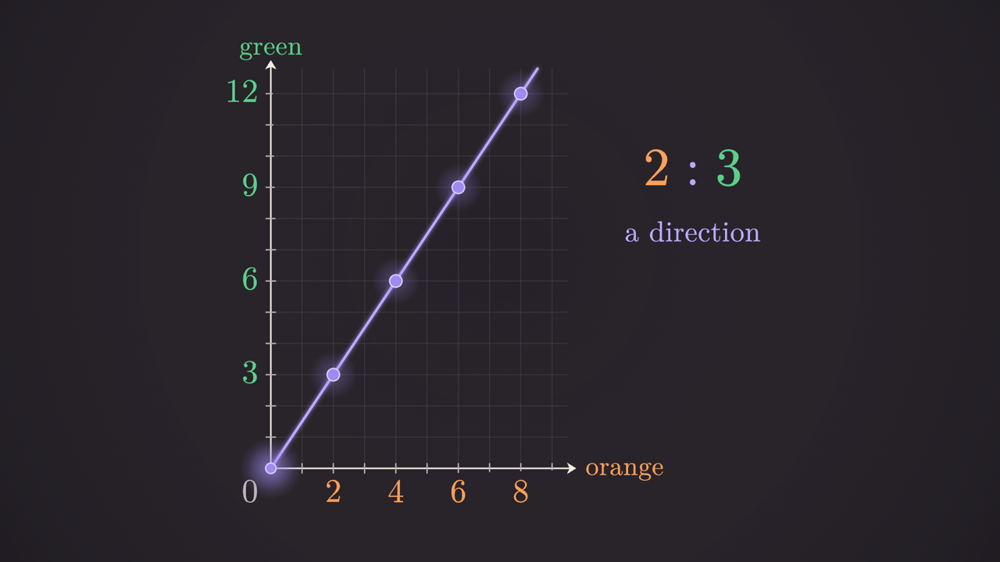

# mathscenes

**One maths scene → a narrated explainer video *and* a live interactive page.**

mathscenes is a small TypeScript engine for maths explanations. You write a script, a voice reads it, and every
animation beat is bound to the exact word that names it. The same scene renders frame by frame to a 1080p MP4 and runs
live in the browser, where a learner can step through it. Maths objects are typed **blocks** (ratio table, double
number line, equation morph, ratio graph, ratio tiles) that compute and check their own maths, so a picture can't show
a wrong answer. It also ships the knowledge of how to build a good explanation (misconception first, rule last),
written down for people and for AI agents.



*From the worked example "What Is a Ratio, Really?" (3:54), rendered silently from this repo:
`node tools/render.mjs ratio --from 127.5 --to 141.5`.*



## How it works

```
script (narration.json, {cue} markers)
   └─ audio/narrate.py ─▶ narration.wav + words.json (every word's start/end, every cue's time)
                                   └─ scene: beats = cue / word times ─▶ TimeDriver (video)  ─┐
                                      same blocks, same draw(progress)  ─▶ StepDriver (steps) ─┤
blocks: compute + validate maths, lay out (readability rules), draw from (params, progress)    │
core: draw-on, TeX write-on per glyph (MathJax 4 → outlines), morphs, camera, easing, glow ◀───┘
   └─ tools/render.mjs: headless Chrome renders frame t → ffmpeg → MP4 (+ audio/mix.py's mix)
```

- **Pure frames**: `draw(c, t)` depends only on `t`; frames render in any order, in parallel, deterministically.
- **TeX as geometry**: MathJax 4 (bundled, offline) turns TeX into glyph outlines that draw on, recolour per part
  (`\cssId{a}{2}`), and morph into each other (a 5 grows the hole of a 6; + turns into ×).
- **Readable by construction**: numbers ≥ 60 px, labels ≥ 44 px, never text over lines; blocks throw a readable
  error instead of drawing something unreadable.
- **Themes, not copies**: colour *roles* (`first`, `second`, `link`, `wrong`, …) resolved by a theme (`ink` dark,
  `paper` light).

## Quick start

Requirements: Node ≥ 20.11, [ffmpeg](https://ffmpeg.org) on PATH (for video), Python ≥ 3.10 (only for the audio
pipeline).

```bash
npm install            # also downloads a headless Chrome for Puppeteer
npm run dev            # http://localhost:5200 : gallery, interactive, player
npm test               # block maths, TeX, cues, scenes build in both themes
npm run typecheck
npm run build          # dist/, fully offline

# render the ratio example (silent: no audio is shipped)
node tools/render.mjs ratio --from 120 --to 150 --out out/ratio_line.mp4
node tools/render.mjs ratio --out out/ratio.mp4                  # the whole video, 0 → 233.9 s
node tools/sheet.mjs ratio --from 0 --to 60 --step 2             # a contact sheet: out/sheet_ratio.jpg
```

Pages (with `npm run dev`): `gallery.html` (every block with live sliders), `interactive.html` (a ratio table and a
double number line driven step by step for your number), `player.html?scene=ratio` (the video scene;
`&t=146.9` for a still, `&theme=paper` for the light theme).

### Audio (optional, bring your own ElevenLabs key)

```bash
pip install -r audio/requirements.txt
cp .env.example .env                     # put your ELEVENLABS_API_KEY in .env (git-ignored)

python audio/narrate.py examples/ratio --dry     # what would be generated (no key needed)
python audio/narrate.py examples/ratio           # media/narration.wav + data/words.json
python audio/gen_sfx.py examples/ratio           # media/sfx/*.mp3 from data/sfx.json prompts
python audio/gen_music.py examples/ratio --variants A B && python audio/gen_music.py examples/ratio --keep A   # optional bed
python audio/mix.py examples/ratio               # media/final_mix.wav (ducked, loudness-normalised)
node tools/render.mjs ratio --audio --out out/ratio.mp4
```

Voices are referenced by name from `audio/voices.example.json` (premade public ElevenLabs voices). Every tool has
`--dry`, which needs no key. Narration lines are cached per line, so editing one line only re-generates that line.
Re-narrating changes the timings slightly; the scene follows automatically (it is bound to words, not times).

## Making your own video

Start with **[AGENTS.md](AGENTS.md)**: the workflow (script → narrate → words.json → scene → review → render), the
review loop and the definition of done. It is written for AI agents and works just as well for people.

| doc | what |
|---|---|
| [docs/PEDAGOGY.md](docs/PEDAGOGY.md) | the explanation spine: misconception first (Derek Muller's research), commit, fair test, rule last |
| [docs/SCRIPTWRITING.md](docs/SCRIPTWRITING.md) | how to build an explanation and how to talk: two script shapes, tone, mechanics, checklist |
| [docs/STYLE.md](docs/STYLE.md) | colour roles, readability, motion, hard-won rules |
| [docs/BLOCKS.md](docs/BLOCKS.md) | the block catalogue and how to add a block |
| [docs/WORDS_FORMAT.md](docs/WORDS_FORMAT.md) | narration.json → words.json, sfx.json, mix.json |
| [docs/TEX_COVERAGE.md](docs/TEX_COVERAGE.md) | what TeX renders, and the workarounds |
| [prompts/](prompts) | templates: write a script, build a scene, review a scene |

## Repo map

```
src/core/        maths (exact rationals), easing, point lists, draw (draw-on, arrow, strike, glow), morph,
                 tex (MathJax 4 → glyph outlines), mathjax (offline setup), theme (roles), clock (TimeDriver, StepDriver)
src/blocks/      RatioTable, DoubleNumberLine, EquationMorph, RatioGraph, RatioTiles (+ block.ts: shared rules)
src/scenes/      SceneDef, typed Narration (cues.ts), the scene registry
examples/ratio/  "What Is a Ratio, Really?": ratio.ts (the scene), ratioWorld.ts (scene painters), cues.ts,
                 data/ (narration, words, sfx, music, mix JSON). No audio is shipped.
pages/           index, gallery, interactive (StepDriver), player (renders frame t for the video renderer)
tools/           render.mjs (MP4), sheet.mjs (contact sheets, stills), shot.mjs, tex-coverage.mjs, tex-zoom.mjs
audio/           Python audio pipeline: narrate, gen_sfx, gen_music, mix (ElevenLabs, your own key)
tests/           Vitest
docs/, prompts/  model context: pedagogy, scriptwriting, style, formats, prompt templates
AGENTS.md        start here to author a scene
```

## Credits and licences

- mathscenes: MIT, see [LICENSE](LICENSE). Copyright (c) 2026 Drmedkit.
- [MathJax](https://www.mathjax.org) 4 (`@mathjax/src`), Apache-2.0: TeX → SVG, bundled for offline use.
- `@mathjax/mathjax-newcm-font`, Apache-2.0: MathJax's packaging of the
  [New Computer Modern](https://ctan.org/pkg/newcomputermodern) fonts (by Antonis Tsolomitis, GUST Font License),
  used for every formula.
- Page UI text uses the system font stack; no web fonts are shipped.
- Dev tools: Vite, Vitest, TypeScript, Puppeteer (all MIT / Apache-2.0). Audio pipeline: requests, python-dotenv,
  NumPy, SoundFile, librosa. Video encoding: ffmpeg (installed separately).
- The pedagogy draws on Derek Muller's PhD research on misconceptions in science videos (University of Sydney, 2008).
- Audio is generated with [ElevenLabs](https://elevenlabs.io) using your own account; generated audio is subject to
  their terms. No generated audio or video is included in this repo.
